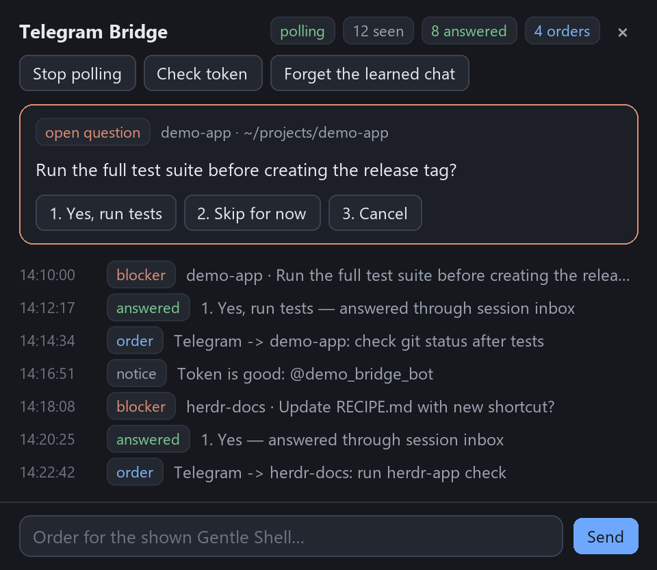

<p align="center">
  
</p>

# Telegram Bridge
A Herdr app mod (`gentle-telegram`) that puts Telegram in the loop of a [Gentle Shell](https://github.com/Pacoaldev) session: the option question a session is blocked on goes to your phone with one button per option, and a message you send from Telegram runs as a prompt in the newest session.

The point is which path answers. A tap writes a `gentle-shell.desktop-action/v1` file (`kind: "answer_question"`, `args: { toolCallId, option, via: "session" }`) into `<agentDir>/desktop/inbox/<sessionId>/`, which is the path that actually unblocks Pi: no terminal keys, no pane scraping.

## Install
Copy and paste this prompt to your LLM agent:
`Read ~/.config/herdr-app/AGENTS.md, then add this mod: https://github.com/Pacoaldev/gentle-telegram/tree/main/mods/gentle-telegram`

Nothing outside the mod folder is required: it talks to Telegram over `fetch` and reads the desktop feed of the Gentle Shell sessions on this machine.

## What it does
| Direction | How |
| --- | --- |
| Gentle Shell → Telegram | Every 4 s it reads `<agentDir>/desktop/sessions/*.json` (`~/.gentle-shell/agent` and `~/.pi/agent`; `GENTLE_SHELL_AGENT_DIR` and `GENTLE_SHELL_HOME` win when set) and picks the newest snapshot whose `activity.state` is `blocked` or `waiting` and whose `pendingQuestion` is a choice with options. That question becomes one message with one inline button per option. |
| Telegram → Gentle Shell (answer) | A tap writes the action file above and then polls the session's `desktop/outbox/<sessionId>/<id>.json` for the session's own answer: the mod never claims the session accepted anything it did not answer. |
| Telegram → Gentle Shell (order) | A text message runs as `send_prompt` in the newest session with an inbox, and falls back to `hc send <address> <text>` in the focused terminal when that session takes no desktop actions. |

Sent once per question: the dedup signature is `gentle-feed:<toolCallId>`, so a re-read of the same snapshot never re-sends, and a question whose file comes back is still not sent twice.

## Settings
| Setting | Key | What it does |
| --- | --- | --- |
| Bot token | `gentle-telegram.token` | The token @BotFather gave you. Herdr saves settings in `settings.json` in clear text: treat that file as a secret. |
| Allowed chats | `gentle-telegram.allowlist` | Chat ids separated by commas. Empty: the first chat that writes becomes the operator's and only it is answered. |
| Poll Telegram | `gentle-telegram.poll` | Off: nothing is sent, no order is relayed, no cost. |
| Relay orders | `gentle-telegram.orders` | Off: a Telegram message is ignored; answers still work. |
| Show the log | `gentle-telegram.details` | The bridge's own log under the open question. |

## Commands
| Command | What it does |
| --- | --- |
| `gentle-telegram.start` / `.stop` | Polling on / off, without deleting the token. |
| `gentle-telegram.check` | Calls `getMe` and says which bot the token belongs to, or what Telegram refused. |
| `gentle-telegram.send` | Sends what the mod's own composer holds. |
| `gentle-telegram.forget-chat` | Drops the learned chat, so the next one that writes becomes the operator's. |

Inside the window: one button per option of the open question (the same answers Telegram offers), the composer, and the log.

## Develop
```bash
node --test tests/                          # 41 tests over the pure logic (lib/)
herdr-app check mods/gentle-telegram        # the mod loads once, and what is wrong is reported
```
`mods/gentle-telegram/lib/` holds the rules (the Telegram wire format, the feed extraction, the action files, the dedup state) with no host imports, so they are unit-tested without a bot, a machine or a window. `runtime.js` is the wiring, `main.js` the view and the loops, `ui.js`/`tokens.js` the drawing.

Untested: a real bot token, a live Pi session, macOS, Linux, and a remote machine's window. See `RECIPE.md`.
