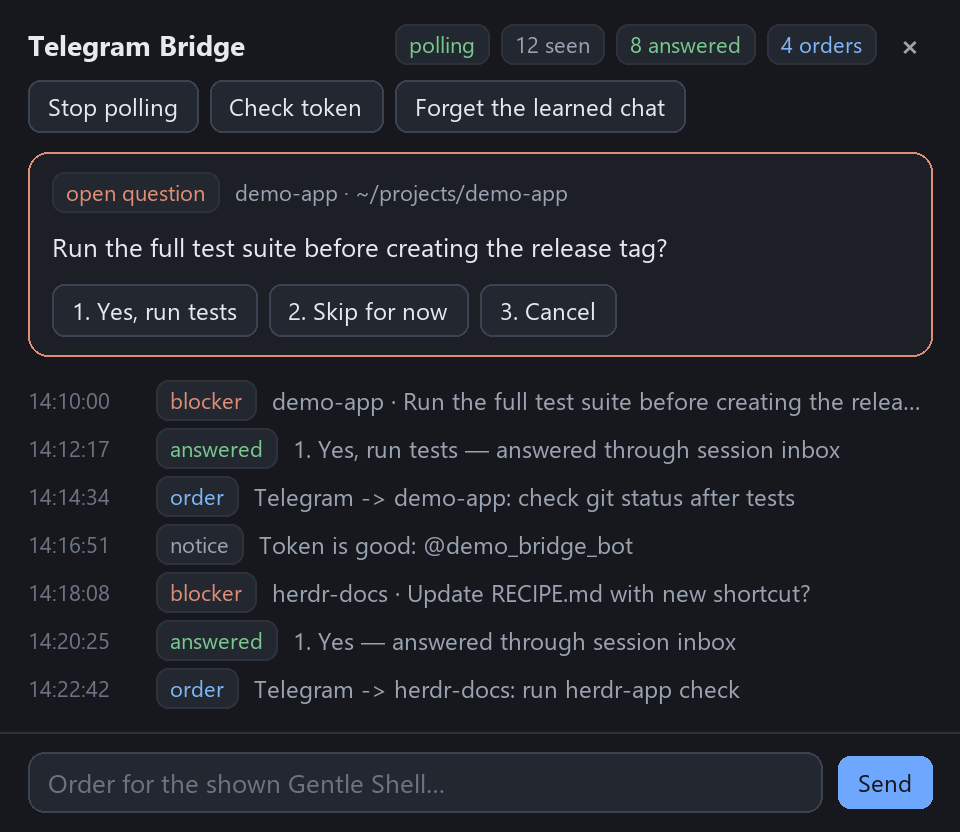

# Telegram Bridge
A Herdr app mod (`gentle-telegram`) that puts Telegram in the loop of a Gentle Shell session: the option question a session is blocked on goes to your phone with one button per option, and a message you send from Telegram runs as a prompt in the newest session.

## What you see
The head "Telegram Bridge" (14px, semibold) with the status pill (`polling`, `idle`, `error`, `working`), three counts (`N seen`, `N answered`, `N orders`, plus `N errors` when there are any), and one row of buttons: **Stop polling** / **Start polling**, **Check token**, **Forget the learned chat**. Under the head, a notice when there is no token, and a notice when polling is off. Then the open question, when there is one: a `raised` card with a 1px `warn` border, the pill `open question`, the session it came from (its name and `cwd`), the question, and one button per option (`1. SI`, `2. NO`), disabled while an answer is in flight and disabled with the line "no agent folder: answer in the session's own TUI" when the snapshot names no inbox to write to. Then the log: the last 14 rows, each the time, a kind pill (`blocker`, `answered`, `order`, `error`, `notice`) and one truncated line. At the bottom, the composer (a borderless `Textarea` in a `raised` box) and the **Send** button. Colours come from the Herdr theme role when it has one (`background`, `chrome`, `surface`, `raised`, `hover`, `border`, `input`, `foreground`, `muted`, `dim`, `accent`, `done`, `blocked`, `working`) and from the token's own hex otherwise.

## How it behaves
- **Feed scan, every 4 s.** The session folders are `<agentDir>/desktop/sessions` for each agent dir: `GENTLE_SHELL_AGENT_DIR`, then `<GENTLE_SHELL_HOME|USERPROFILE|HOME|home()>/.gentle-shell/agent`, then `.../.pi/agent`. Every `*.json` is read; a file that does not parse is skipped, never reported as a blocker. `pendingFrom` keeps a snapshot whose `activity.state` is `blocked` or `waiting`, whose `pendingQuestion.kind` is `choice`, and whose options are non-empty (a `prompt` question has no buttons, so it is not sent); the option list is capped at ten, as the feed is. `pickPending` takes the newest of those.
- **Sent once.** The signature is `feedSignature` = `gentle-feed:<toolCallId>`; it is remembered in `shared("gentle-telegram.state").seen` (200 entries, oldest dropped) and marked *before* the send, so a Telegram failure does not turn into the same question every 4 s. The card in the window stays, and the log says what Telegram refused.
- **A tap answers through the session.** `inlineKeyboard` sends one button per option, one column up to four options and two per row beyond that, with `callback_data` = `a:<toolCallId>:<index>` (the tool call id is protected with `encodeURIComponent`). The poll decodes it with `decodeUpdate`; the mod writes the action with `writeInbox`-equivalent rules in `lib/actions.js` and validates it with `validateAction` (schema, kind, key set, option index 0..63, `via` must be `session`). Then `awaitResult` polls `<agentDir>/desktop/outbox/<sessionId>/<id>.json` every 80 ms for up to 6 s and parses it with `parseActionResult`, which accepts only a result whose `id` matches the action. No result is reported as unknown, never as a success; the button's Telegram answer says what happened and the message is edited to `✅ <option>`.
- **An order goes to a session, else to the terminal.** A text message (with the allowlist filtering who may send one) runs as `kind: "send_prompt"` in the newest session that has an inbox, and falls back to `hc send <focused address> <text>` when the session has no inbox or no session is known. The Telegram reply names where it went, and the log records it.
- **Who may talk.** An empty allowlist lets the *first* chat that writes become the operator's, remembered in `shared("gentle-telegram.state").chatId`, and answers only that one afterwards; a written allowlist decides on its own. A chat that is not allowed is ignored and never answered.
- **Waiting on the session, and the "newest" problem.** `fs/promises` in a mod has `readFile`, `writeFile`, `readdir`, `exists`, `unlink`, `rmdir`, `mkdir` — **no `stat`**. "Newest session" therefore comes from two honest sources: a `watchFolder` per session folder, whose reported changes stamp the file with the moment the change was seen (a bounded map of 128 paths), and a timestamp inside the snapshot when it carries one (`updatedAt`, `updated_at`, `activity.at`). A session that is blocked wrote its snapshot when it became blocked, so it is at the front of the order a moment later. With several sessions blocked and no watch event since the mod started, the order is the file name's — reported here, not hidden.
- **Host discipline.** Ambient reads (`shared`, `focused`, `home`, `terminals`) happen synchronously at the head of a host call. Everything a fetch or a file returns is turned into UI inside `cx.timer.after(1, ...)`. Every loop checks `live(cx)` (a `try { cx.phase() } catch`) after each wait, so a reloaded build stops running instead of continuing with code nobody shows. The `herdr-mods.disabled` list is honoured: off, the mod draws nothing and its loops only sleep.
- **The token.** `shared("gentle-telegram.token")` from `kit.json`, and nothing else: there is no environment-variable fallback, so a token set outside the setting is ignored. Nothing about NOX9GO's configuration is reused, and the token is never logged: a failed call logs what Telegram said (`Telegram refused getMe: ...`), not the token.
- Errors are deduped: the same complaint is logged once a minute at most, so a Telegram outage cannot fill the log.
## Built from
- An earlier internal review of a Telegram bridge in another Gentle Shell setup (NOX9GO): the detection order (desktop feed first), dedup by `toolCallId`, and the `answer_question`/`via: "session"` inbox path over pane keys.
- The Gentle Shell desktop contracts `gentle-shell.desktop-feed/v1` (the session snapshot: `activity.state`, `identity.sessionId`, `identity.agentDir`, `pendingQuestion.{kind,tool,toolCallId,question,options[]}`) and `gentle-shell.desktop-action/v1`.
- The publication shape of `Pacoaldev/gentle-agent-cards` (`mods/<name>/`, `kit.json`, `RECIPE.md`, `preview.json`, a README with an install prompt).
- Herdr's mod API: `herdr` (`shared`, `setShared`, `nextCommand`, `watchFolder`, `hc`, `focused`, `terminals`, `home`, `theme`, `notify`), `gpui-kit` (`View`, `div`), `gpui-base` (`v_flex`, `h_flex`, `Textarea`, `TextareaState`), `fs/promises`.
- No new dependency, and no network call except to `api.telegram.org`.
## Watch out
- **The mod's `fs/promises` has no `stat`, and `herdr-app check` is what tells you**: it failed with `Could not find export 'stat' in module 'fs/promises'` before the recency map replaced it. Check the mod after every host import you add; a wrong export is a load failure, not a runtime error.
- **A mod window is a `place: "none"` mod**, so it registers its commands only once a pane instantiates it: `herdr-app do` on it needs the mod open in a pane first, and the ⌘-list entry comes from `kit.json`'s `"key"` setting.
- **`herdr-app check` passes with one warning**: `a reload stranded script tasks that will never settle (3 a HostModule's async function, 1 cx.sleep(ms)); re-register background work from init()`. The loops stop correctly (`live(cx)`), but a reload still leaves the timer and host calls stranded; a fresh build should re-register its background work from `init()` instead of at module scope.
- **Streams and `fetch`.** A long poll holds the promise for 25 s (`POLL_TIMEOUT_DEFAULT`), and a Telegram failure logs the description Telegram sent, never the URL: the URL carries the bot token.
- **`cx.sleep` is the host's timer.** `lib/` stays free of it (the runtime takes `sleep` as an argument), which is what lets the outbox wait be tested without a window.
- **Never `bg()` a raw `theme()` value**: it may be missing on some setups and an `undefined` colour surfaces as "child(value) expects an element". `tokens.js` reads a role and falls back to the token's own hex.
- **A render error keeps the pane on the failed version** (the banner "This view could not be re-rendered" stays after the fix): close the pane and split it again.
- `preview.png` is a **sanitized mock**, not a shot of a real window: `tools/preview-mock.py` draws it from `tokens.js` hex fallbacks and the sizes in `ui.js`, so it carries no session name, cwd, token or feed data (the hub screenshot must never carry those). Regenerate it with `python tools/preview-mock.py`; replace it with a real `herdr-app shot` once a real session's card can be cropped to the panel alone. Never commit a full-window shot (secrets and cwd leak in the README).
- Verified on this machine (Windows): the mod loads in a pane (`pane.split --direction right --mod gentle-telegram`) and as an overlay with `"errors": []`, and it draws its card with the missing-token notice, not the "This view could not be re-rendered" banner.
- Verified end-to-end on this machine (Windows, Herdr 0.1.17, bot `@Gentle9Bot`, 2026-11-24): `gentle-telegram.check` answers `Token is good: @Gentle9Bot` with a real token, which also proves that a mod's own `fetch` reaches `api.telegram.org` (the probe mod at `tests/probe-network/` is no longer the only evidence for that, and `herdr-app check` still strands its task at teardown, so it needs the live window); a session blocked on a choice arrives with one button per option; a tap answers it in the session and the whole path runs (inbox `answer_question` with `via: "session"`, the outbox result, `answered` logged, the Telegram message edited to `✅ <option>`); a Telegram text message appears as a prompt in the newest session with an inbox.
- Still untested: macOS, Linux, a remote machine's window, group chats, a `pendingQuestion` of kind `prompt`, and the `hc send` fallback when the newest session has no inbox.
## Done when
- `node --test tests/` is 53 pass / 0 fail, and `herdr-app check mods/gentle-telegram` passes.
- With a token set: `gentle-telegram.check` answers which bot it is; with a session blocked on a choice, the question arrives with one button per option; a tap answers it in the session (the outbox result says so) and the message turns into `✅ <option>`.
- With polling on and a session with an inbox, a Telegram message appears as a prompt in that session.

Observed end-to-end on 2026-11-24 (Windows, Herdr 0.1.17, `@Gentle9Bot`): `Token is good: @Gentle9Bot` with a real token; 6 choice questions sent, one button per option; 3 answers completed through the button and logged as `answered`; 1 Telegram message delivered to the newest session as a prompt. Still unobserved: macOS, Linux, a remote machine's window, group chats, a `pendingQuestion` of kind `prompt`, and the `hc send` fallback.
